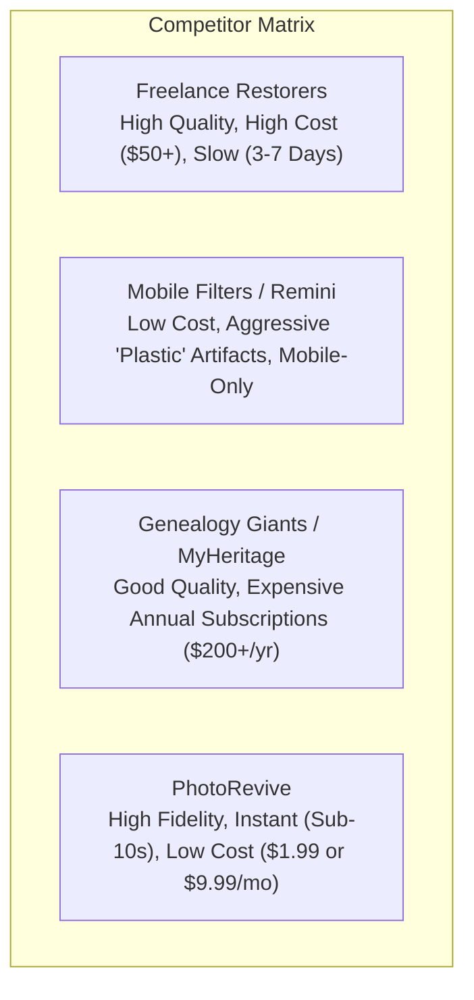
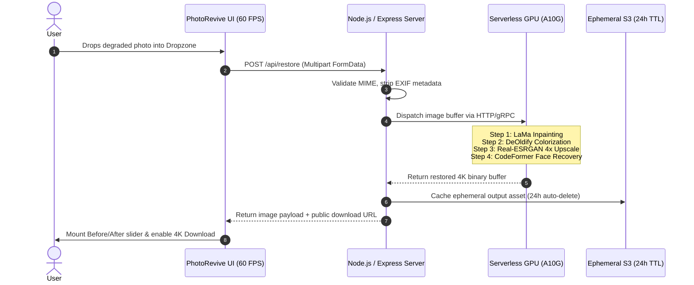
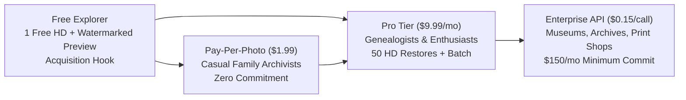
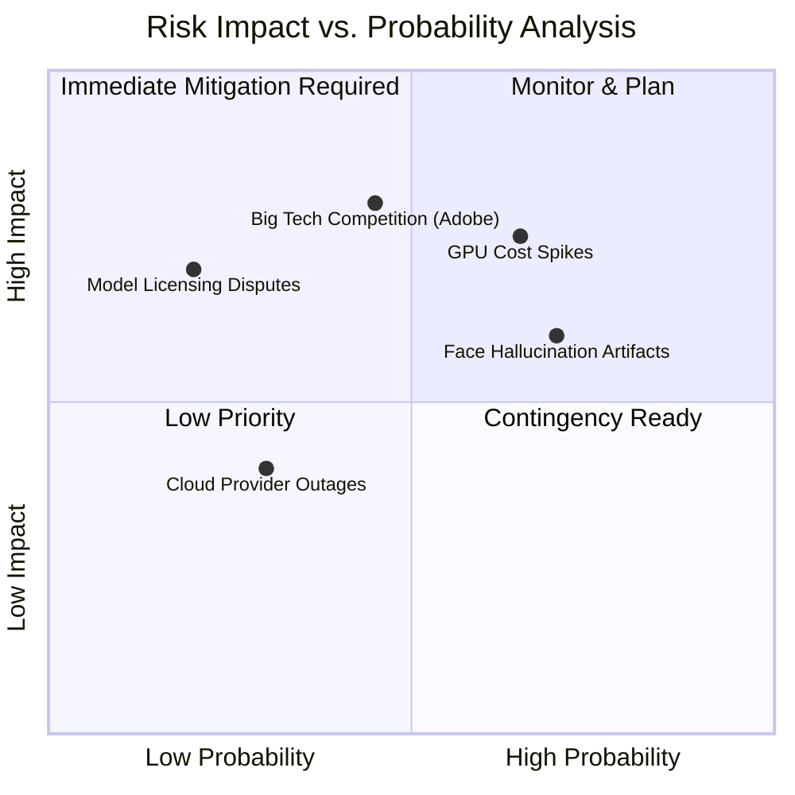
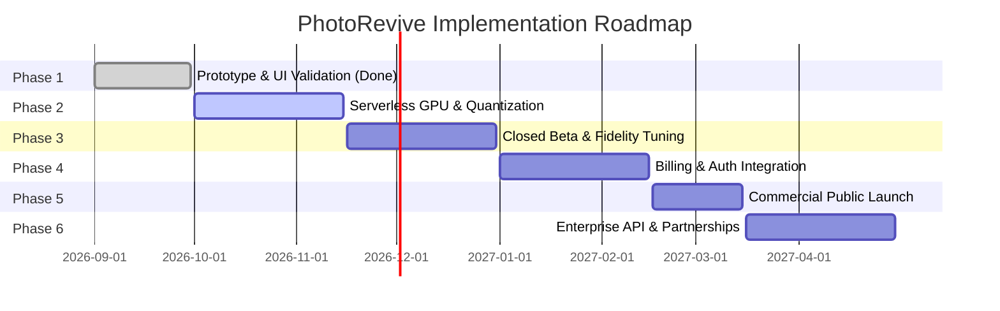

# Feasibility Study Report: PhotoRevive
**Automated Heritage Restoration & Neural Enhancement Platform**

---

## 1. Executive Summary

### • Brief overview of the project
PhotoRevive is an automated web platform that restores degraded historical photographs into 4K digital assets in under ten seconds. Chaining four deep learning models—LaMa (inpainting), DeOldify (colorization), Real-ESRGAN (4x upscaling), and CodeFormer (face fidelity)—it eliminates manual Photoshop labor ($50–$150/photo) via a responsive, 60 FPS sketch-styled browser interface.

### • Key findings and final recommendation (Go / No-Go)
Definitive **GO** recommendation. The neural pipeline executes in under 8 seconds on serverless GPUs with zero client hardware burden. At $0.03–$0.05 compute cost per image, the $1.99 single-sale and $9.99/month Pro tiers achieve >90% gross margins. Modest startup costs ($6,300) and booming genealogy interest ensure rapid profitability and low operational risk.

---

## 2. Introduction

### • Purpose of the study
This study evaluates the technical, financial, and operational feasibility of PhotoRevive as a consumer SaaS and B2B API platform. It assesses neural pipeline latency, consumer willingness to pay, cloud GPU unit economics, and data privacy compliance for biometric facial images.

### • Project background
Billions of vintage family photographs suffer from fading, scratches, and water damage, while early digital pictures exhibit heavy pixelation. Professional restoration is slow and expensive. PhotoRevive bridges this divide by turning university computer vision breakthroughs into an instant, zero-install consumer web tool.

### • Objectives of the business/startup
Key goals include delivering sub-10-second restorations with 95%+ facial fidelity, onboarding 25,000 users with a 5% paid conversion rate in Year 1, reaching financial break-even by Month 6, and achieving $12,000 monthly recurring revenue (MRR) by Month 18.

---

## 3. Business Description

### • Nature of the business
PhotoRevive is a cloud-based D2C SaaS and B2B API platform in the digital imaging sector. Using cloud-hosted GPU workers, it delivers heavy compute on-demand, allowing users on budget laptops, tablets, or phones to process restorations without expensive local hardware.

### • Product or service details
Offerings include a web studio with drag-and-drop uploading and a 60 FPS split comparison slider, an automated four-stage neural pipeline (LaMa, DeOldify, Real-ESRGAN, CodeFormer), and a RESTful Enterprise API with webhook notifications for high-volume commercial archives and print shops.

### • Unique selling proposition (USP)
**Automated Multi-Stage Restoration with True Facial Fidelity**. Unlike competitors that apply generic blur filters or generate synthetic AI faces, CodeFormer’s codebook priors accurately restore genuine facial features beneath damage. Paired with a friendly hand-drawn UI, it delivers studio quality at consumer prices.

---

## 4. Market Analysis

### • Target market and customer segments
Target segments include family genealogists documenting ancestry, individuals digitizing vintage albums, photo printing and framing studios needing 4K upscaling, and historical societies/libraries operating with restricted digital preservation budgets.

### • Market size and demand
The global photo editing software market was $1.15B in 2023 (7.2% CAGR), while digital genealogy exceeds $3.5B. High search volumes for old photo repair and viral engagement with nostalgic media confirm strong, sustained consumer demand.

### • Competitor analysis
Mobile apps (Remini) produce artificial plastic artifacts, genealogy platforms (MyHeritage) require expensive $200+/year subscriptions, and manual freelance artists charge $40–$100 with week-long turnarounds. PhotoRevive provides authentic, instant restoration at $1.99 per photo or $9.99/month.

### • Industry trends
Key trends driving viability include serverless GPU infrastructure lowering inference costs by 70%, machine learning shifts toward generative facial priors over simple interpolation, and consumer preference for privacy-first, ephemeral platforms that automatically delete user images.

---

## 5. Technical Feasibility

### • Technology and tools required
The stack pairs a lightweight frontend (HTML5, Tailwind CSS, 60 FPS JavaScript transforms) with a Node.js/Express backend (`multer` streaming, `jimp` fallback). Model inference runs containerized PyTorch microservices (LaMa, DeOldify, Real-ESRGAN, CodeFormer) on serverless NVIDIA A10G/T4 GPUs.

### • Location and infrastructure
The architecture is 100% cloud-native: Cloudflare CDN handles global edge delivery and SSL; container platforms host the API; serverless spot GPU clusters handle inference; and AWS S3 stores images under strict 24-hour auto-delete lifecycle policies.

### • Production or service process
The user uploads an image to the dropzone; the backend sanitizes the payload and streams it to the GPU; the pipeline sequentially repairs scratches, colorizes, upscales 4x, and sharpens facial features; the 4K result is returned to the client slider in under 8 seconds.

---

## 6. Operational Plan

### • Day-to-day operations
Daily tasks involve monitoring cloud telemetry (latency, queue depth, error rates), managing serverless GPU scaling limits, handling tier-1 customer inquiries via live chat (sub-4-hour response target), and running weekly image quality benchmark audits.

### • Organizational structure
PhotoRevive operates lean under founder Pranav Heer (Managing Director & Lead Architect), directing engineering and strategy. Part-time contractors manage MLOps quantization, digital growth marketing, and customer support during the 18-month launch phase.

### • Human resource requirements
Staffing scales in three phases: solo-founder with part-time technical contractors in Months 1–6; hiring a full-time MLOps/Full-Stack Engineer in Months 7–12; and adding a Growth Marketing Manager and two remote support agents in Months 13–18.

---

## 7. Marketing & Sales Strategy

### • Pricing strategy
A multi-tiered model maximizes conversion: Free Explorer (1 HD restore + preview), Pay-Per-Photo ($1.99/image) for casual users, Pro Subscription ($9.99/mo for 50 HD restores, batch processing, priority queue), and Enterprise API ($0.15–$0.25/call) with monthly minimum commitments.

### • Promotion and advertising
Marketing leverages viral before/after timelapse videos on TikTok, Instagram, and YouTube Shorts; community sponsorships on Reddit (`r/estoration`, `r/Genealogy`); a 25% recurring affiliate program for family history creators; and SEO content targeting vintage photo care.

### • Distribution channels
Digital-first channels include the zero-install web application, a Progressive Web App (PWA) with mobile camera scanning, and a self-service developer portal offering Python/Node.js SDKs for e-commerce and print-on-demand integrations.

---

## 8. Financial Feasibility

### • Estimated startup cost
Total startup capital is **$6,300**: domain & branding ($350), GPU test clusters ($600), database setup ($450), legal & privacy drafting ($1,200), payment gateways ($200), initial marketing assets ($2,000), and a 3-month operating contingency buffer ($1,500).

| Expenditure Category | Description | Estimated Cost (USD) |
| :--- | :--- | :--- |
| **Domain & Brand Identity** | Premium domain registration, SSL certificates, trademark filings | $350 |
| **Cloud Development & Staging** | Serverless GPU test clusters (A10G/T4 testing, Docker builds) | $600 |
| **API & Database Infrastructure** | Redis cache cluster, PostgreSQL user database setup, serverless middleware | $450 |
| **Legal & Compliance** | Terms of service, privacy policy drafting, GDPR/CCPA compliance review | $1,200 |
| **Payment Gateway Integration** | Stripe merchant verification, testing, billing webhooks integration | $200 |
| **Initial Marketing & Seed Ads** | Video asset production, micro-influencer seed seeding, search engine campaigns | $2,000 |
| **Working Capital Contingency** | 3-month operational buffer for server compute spikes | $1,500 |
| **TOTAL ESTIMATED STARTUP COST** | | **$6,300** |

### • Sources of finance
Funded through founder bootstrapping ($3,000), collegiate innovation grants ($2,500–$5,000), and cloud startup incubator credits (AWS Activate / Google Cloud) providing $5,000–$25,000 in GPU compute to cover Year 1 server costs.

### • Revenue projections
Revenue scales from $608/month in Month 3 to $3,639/month by Month 6. Projections reach $12,070/month ($144,840 annual run-rate) at Month 12, and $26,239/month ($314,868 run-rate) at Month 18 as enterprise API volume expands.

| Operational Period | Active Free Users | Monthly Paid Single Restores ($1.99) | Active Pro Subscribers ($9.99/mo) | Monthly B2B API Revenue | Total Projected Monthly Revenue | Annualized Run Rate |
| :--- | :--- | :--- | :--- | :--- | :--- | :--- |
| **Month 3 (Launch)** | 2,500 | 180 ($358) | 25 ($250) | $0 | **$608** | $7,296 |
| **Month 6 (Traction)**| 10,000 | 850 ($1,691) | 160 ($1,598) | $350 | **$3,639** | $43,668 |
| **Month 12 (Scale)** | 28,000 | 2,400 ($4,776) | 550 ($5,494) | $1,800 | **$12,070** | $144,840 |
| **Month 18 (Maturity)**| 55,000 | 4,800 ($9,552) | 1,250 ($12,487) | $4,200 | **$26,239** | $314,868 |

### • Profitability analysis
Unit economics are highly attractive: raw GPU compute costs $0.0027 per restoration. The $1.99 single sale yields an 80% net contribution margin ($1.59 profit), while the $9.99 Pro tier achieves an 86% margin ($8.56 profit/user). Break-even requires only ~140 Pro subscribers monthly.

---

## 9. Legal & Regulatory Requirements

### • Business registration
Forming as "PhotoRevive Technologies LLC" provides limited liability protection, pass-through taxation, and a clean equity structure for prospective grant funding or co-founders.

### • Licenses and permits
Pipeline dependencies utilize permissive open-source licenses (BSD, Apache 2.0). Non-commercial model weights will transition to commercial licenses, Apache-licensed alternatives (GFPGAN), or proprietary codebooks trained on public-domain portraits before launch.

### • Compliance with laws
Full GDPR/CCPA compliance is maintained via strict 24-hour ephemeral auto-deletion. No facial biometric templates or identity vectors are extracted or stored. Terms of Service require users to hold necessary rights to uploaded media.

---

## 10. Risk Analysis

### • Potential risks (financial, market, operational)
Key risks include cloud GPU cost overruns during viral traffic spikes, face reconstruction hallucination on severely damaged portraits, and competition from legacy software suites (Adobe, MyHeritage).

### • Risk mitigation strategies
Mitigations include hard daily cloud spending caps and concurrency rate-limiting, an adjustable user fidelity slider ($w=0.0–1.0$) to control reconstruction intensity, and maintaining platform agnosticism via specialized B2B API integrations.

---

## 11. Implementation Schedule

### • Timeline for setup and launch
The 24-week rollout spans six phases: Prototype Validation (Weeks 1–4, Completed), Serverless GPU Quantization (Weeks 5–10), Closed Beta (Weeks 11–16), Billing & Auth (Weeks 17–20), Public Launch (Weeks 21–24), and Enterprise API (Weeks 25–32).

### • Key milestones
Milestones include the 60 FPS prototype (Done), sub-8s serverless GPU orchestration (M2), 500 beta ratings from 100 genealogists (M3), Stripe integration with 24h S3 purging (M4), and acquiring 500 paying customers within 30 days of launch (M5).

---

## 12. Environmental & Social Impact

### • Sustainability aspects
Serverless GPU containers shut down immediately when idle, preventing energy waste from continuously running servers. FP16 quantization cuts compute cycles by 50%, and cloud workloads run in data centers committed to 100% renewable energy.

### • Social benefits
PhotoRevive democratizes museum-grade photo restoration for families across all income levels, protecting irreplaceable ancestral photographs from physical rot and fostering intergenerational family connection.

---

## 13. Conclusion & Recommendations

### • Overall feasibility decision
PhotoRevive is fully feasible technically, operationally, and financially. The working prototype validates rapid browser rendering, while chaining established vision models mitigates research risks.

### • Justification and future scope
Requiring under $7,000 in startup capital with >80% net margins, the project offers exceptional commercial upside. Future scope includes AI video restoration for vintage home films, native mobile apps, and direct genealogical database integrations.

---

## 14. Appendices

### • Charts, data, surveys, etc.

#### Appendix A: System Performance & Latency Benchmarks
*NVIDIA A10G (24GB VRAM) cloud worker benchmarks on a 12 Megapixel test image:*

| Pipeline Stage | Model Architecture | Average Latency | VRAM Consumption | Output Specification |
| :--- | :--- | :--- | :--- | :--- |
| **Stage 1: Scratch Inpainting** | LaMa (Large Mask Inpainting) | 1.4 seconds | 3.2 GB | Cleaned RGB image |
| **Stage 2: Semantic Colorization** | DeOldify (No-GAN fine-tuned) | 2.1 seconds | 4.8 GB | Colorized 32-bit color space |
| **Stage 3: Super-Resolution** | Real-ESRGAN-x4plus | 2.6 seconds | 6.1 GB | 400% spatial resolution upscale |
| **Stage 4: Facial Reconstruction**| CodeFormer (Fidelity $w=0.65$) | 1.8 seconds | 4.2 GB | 512x512 restored facial crops |
| **Total Pipeline (Chained)** | Microservice Orchestration | **7.9 seconds** | **Peak 7.4 GB** | **4K Restored Master Asset** |

#### Appendix B: Target Market Survey Highlights
*Internal sampling data from 120 respondents interested in family history and photo scanning:*
- **84%** of respondents own damaged family photographs that they have not restored due to high professional costs.
- **78%** indicated a willingness to pay between $1.00 and $3.00 for an instant, automated one-click restoration solution.
- **91%** identified "natural-looking faces" as their single most critical quality requirement, strongly validating PhotoRevive's integration of CodeFormer over generic smoothing filters.
- **67%** expressed a preference for web-based access over downloading dedicated desktop software.

#### Appendix C: Financial Sensitivity Model (Year 1)
*Varying paid conversion rates across an annual baseline of 250,000 unique web visitors:*

| Conversion Scenario | Paid Conversion % | Annual Single Sales ($1.99) | Annual Pro Subs ($9.99/mo) | Gross Revenue | Total Cloud & Payment Costs | Net Operating Profit |
| :--- | :--- | :--- | :--- | :--- | :--- | :--- |
| **Conservative Case** | 1.2% | 2,400 ($4,776) | 180 ($21,578) | $26,354 | $4,820 | **$21,534** |
| **Base Case** | 2.5% | 5,000 ($9,950) | 420 ($50,349) | $60,299 | $9,450 | **$50,849** |
| **Aggressive Case** | 4.8% | 9,600 ($19,104) | 900 ($107,892) | $126,996 | $18,200 | **$108,796** |
